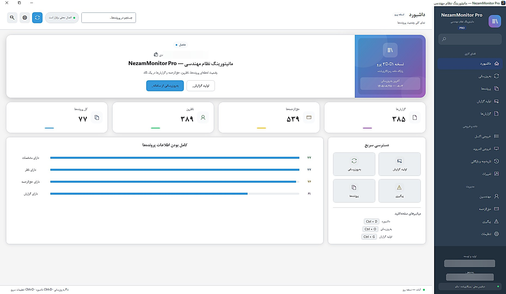
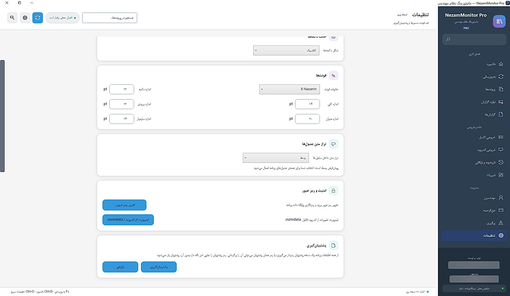
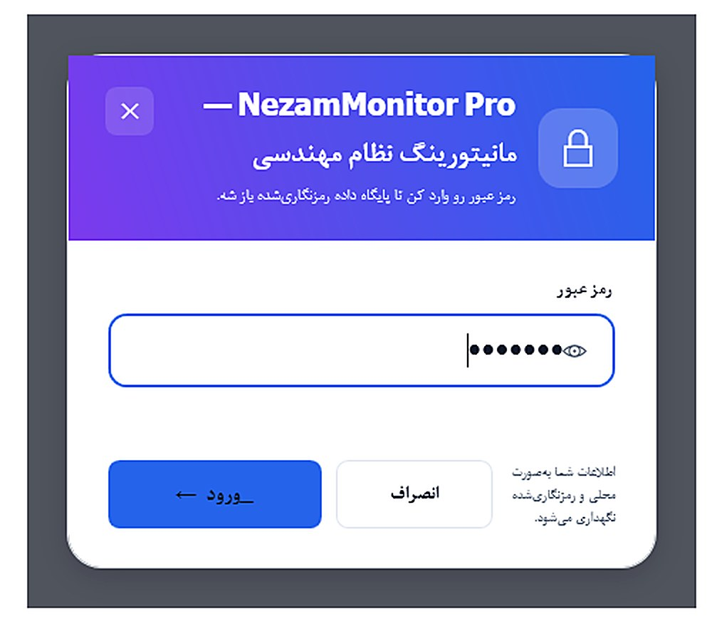

# NezamMonitor Pro — سیستم جامع پایش و مدیریت پرونده‌های نظام مهندسی

> نسخهٔ ویندوز نرم‌افزار مدیریت پرونده‌های نظام مهندسی — همگام با نسخهٔ اندروید

**نسخهٔ کنونی: 12.11** — [دانلود آخرین نسخه](https://github.com/Barkhordari-dev/NezamMonitor/releases)

[](https://github.com/Barkhordari-dev/NezamMonitor/releases) [](https://dotnet.microsoft.com/) [](https://learn.microsoft.com/en-us/dotnet/desktop/wpf/) [](https://github.com/Barkhordari-dev/NezamMonitor/releases) [](https://www.zetetic.net/sqlcipher/)

[🌐 وب‌سایت معرفی و دانلود](https://nezammonitor-pro.ai.studio/) · [⬇️ دریافت آخرین نسخه](https://github.com/Barkhordari-dev/NezamMonitor/releases) · [🤖 نسخه اندروید](https://github.com/Barkhordari-dev/NezamMonitor-Android-UI)

---

## این برنامه برای چه کسی است و چه کار می‌کند؟

**نظام مانیتور پرو (NezamMonitor Pro)** نسخهٔ ویندوز نرم‌افزار مدیریت پرونده‌های نظام مهندسی است، برای مهندسان ناظر و طراحِ عضو سازمان نظام مهندسی استان یزد که از سامانهٔ [service.yazdnezam.ir:8033/panel](http://service.yazdnezam.ir:8033/panel/) استفاده می‌کنند.

با یک بار ورود به سامانه، همهٔ پرونده‌ها، مشخصات مهندسین، وضعیت مراحل و اطلاعات مالی به‌صورت خودکار استخراج و در پایگاه دادهٔ محلیِ رمزنگاری‌شده ذخیره می‌شوند؛ بعد از آن دیگر نیازی به ورود مکرر به سامانه و استخراج دستی اطلاعات نیست — همه‌چیز روی رایانهٔ خودتان قابل جستجو، ویرایش، پیگیری و گزارش‌گیری است، حتی بدون اینترنت.

🎬 [معرفی ویدیویی کامل برنامه (ویندوز و اندروید)](https://nezammonitor-pro.ai.studio/) — در ۸ فصل کوتاه با استخراج خودکار پرونده‌ها، محاسبه حق‌الزحمه، تولید گزارش‌های Word و PDF و همگام‌سازی امن آشنا شوید.

## نمایی از برنامه

| داشبورد | تنظیمات |
|---|---|
|  |  |
| آمار پرونده‌ها، ناظرین، حق‌الزحمه و گزارش‌ها در یک نگاه | تم، فونت، امنیت و پشتیبان‌گیری |

| ورود با رمز عبور |
|---|
|  |
| پایگاه دادهٔ محلی با رمز عبور شما رمزنگاری می‌شود |

> در تصویرها نام و نشانی تماس برای حفظ حریم خصوصی محو شده‌اند.

## امکانات

| بخش | چه کاری انجام می‌دهد؟ |
|---|---|
| 🔄 همگام‌سازی خودکار | ورود یک‌باره به سامانهٔ یزد؛ استخراج و به‌روزرسانی خودکار پرونده‌ها، مهندسین، مراحل و اطلاعات مالی |
| 📋 پرونده‌ها | مشاهده، جستجو و فیلتر پیشرفته؛ جزئیات کامل هر پرونده (مشخصات مالک، نشانی، رشته‌ها، ناظرین، وضعیت مراحل)؛ یادداشت پیگیری |
| 👷 دفترچهٔ دفترها و مهندسین | دفترها و مهندسین یزد (۲۰۳ دفتر، ۵٬۰۷۹ مهندس)؛ مشاهدهٔ دفتر و پروفایل مهندس از جدول پرونده‌ها |
| 💰 حق‌الزحمه | محاسبه بر اساس مالک، مرحله، رشته و وضعیت پرداخت؛ پیگیری اقساط، فیش‌های واریزی و وضعیت تسویه |
| 📄 گزارش Word | گزارش‌های استاندارد مرحلهٔ اول تا چهارم با قالب‌های حرفه‌ای؛ جایگذاری خودکار «نام ناظر»؛ خروجی PDF |
| 📥 خروجی و پشتیبان | صدور گزارش‌های جامع به Excel؛ بستهٔ `.nzmdata` برای انتقال به نسخهٔ اندروید؛ پشتیبان‌گیری و بازیابی کامل |
| 🔒 امنیت | پایگاه دادهٔ محلی رمزنگاری‌شده (SQLCipher)؛ هش رمز عبور با Argon2id؛ تغییر امن رمز عبور از داخل برنامه |
| 🎨 رابط کاربری | کاملاً فارسی و راست‌چین؛ تم‌های روشن و تاریک؛ فونت‌های استاندارد فارسی و خوانایی بالا |

## ✨ تازه‌های نسخهٔ 12.11

- **عکس پروفایل مهندس‌ها:** عکس پروفایل مهندس‌ها نشان داده نمی‌شد؛ درست شد — عکس حالا با روش مقاوم دانلود و از حافظه نشان داده می‌شود، و اگر نرسد دلیلش در لاگ خطا نوشته می‌شود.
- **حروف فارسی:** چند حرف (مثل ِ ُ ٍ و ئ و ٔ) در پنجره‌های دفتر، مهندس و ویزارد به‌صورت مستطیل نشان داده می‌شدند؛ درست شدند.

### در نسخه‌های 12.6 تا 12.10

- **12.10:** پروفایل مهندس با خطا باز نمی‌شد؛ درست شد. قالب‌ها حالا در پوشهٔ `templates` هستند، کنار فایل اجرایی نیستند.
- **12.9:** ردیف سوم توضیحات (و بیشتر) در Word چپ نوشته می‌شد؛ درست شد — ردیف تازه حالا تنظیم راست‌به‌چپ قالب را هم با خودش می‌آورد. مثلث کنار دکمه‌های «بازگشت» و «بعدی» درست شد.
- **12.8:** قدم تازهٔ «متن کامل توضیحات» در ویزارد آمد؛ دفترچهٔ دفترها و مهندسین یزد به برنامه آمد.
- **12.6:** ویزارد مرحله‌ای ساخت گزارش («صدور مرحله‌ای گزارش») از اندروید به ویندوز آمد.
- **12.5:** جایگذاری «نام ناظر» در گزارش — اسم و فامیل همان حسابی که با آن وارد سامانه شده‌اید — با گیومهٔ فارسی یا ساده، در Word و PDF.

## 📥 دانلود و نصب

**ریلیز رسمی v12.11:** [Releases](https://github.com/Barkhordari-dev/NezamMonitor/releases)

| فایل | توضیح |
|------|-------|
| NezamMonitor-Windows-Phase123-v12.11-Portable.zip | نسخهٔ قابل‌حمل (بدون نیاز به نصب) |

### نصب

1. فایل zip را دانلود کنید.
2. آن را در یک پوشهٔ خالی استخراج کنید (پوشهٔ `templates` باید کنار فایل اجرایی بماند).
3. فایل `NezamMonitorPro.exe` را کنار پوشهٔ `data` برنامه‌تان بگذارید و اجرا کنید.
4. در اولین اجرا، یک رمز عبور قوی برای رمزنگاری پایگاه دادهٔ محلی تعیین کنید.

> **نکته:** برنامه به‌صورت Self-Contained ارائه می‌شود و نیازی به نصب جداگانهٔ .NET Runtime ندارد. ساخت از روی سورس به SDK نسخهٔ ۱۰ دات‌نت نیاز دارد.

## 📋 پیش‌نیازهای سیستم

| مورد | حداقل مورد نیاز |
|---|---|
| سیستم‌عامل | ویندوز ۱۰ یا ۱۱ (۶۴ بیت) |
| حافظهٔ رم | ۴ گیگابایت |
| فضای دیسک | حدود ۱۵۰ مگابایت |
| نرم‌افزار اختیاری | Microsoft Word (برای مشاهدهٔ گزارش‌ها) |

## 🔄 ارتباط با نسخهٔ اندروید

داده‌ها میان نسخهٔ ویندوز و نسخهٔ اندروید با فایل `.nzmdata` (قالب v2) جابه‌جا می‌شوند:

```
Windows (v12.11) → Export (.nzmdata v2) → Android (v3.11.8)
Android (v3.11.8) → Follow-up Edits → Export → Windows (v12.11)
```

- **بسته‌های رمزدار:** رمزنگاری **AES-256-GCM** با کلید مشتق **PBKDF2-SHA256** (۶۰۰٬۰۰۰ تکرار) و بررسی صحت **SHA-256** — با رمز عبور یا بدون رمز.
- **حفظ پرونده‌های بایگانی‌شده:** وارد کردن فایل جدید هرگز پرچم بایگانی را حذف نمی‌کند.
- **ادغام هوشمند پیگیری‌ها:** تازه‌ترین زمان ویرایش (`updatedAt`) اعمال می‌شود و در صورت تساوی، نسخهٔ ویندوز برنده است.
- **سازگاری کامل:** ویندوز v12 به بعد با اندروید v3.11.8 (قالب v2) هماهنگ است.

📲 نسخهٔ اندروید: [NezamMonitor-Android-UI](https://github.com/Barkhordari-dev/NezamMonitor-Android-UI) — نسخهٔ v3.11.8

## 🏗️ برای کاربران سامانهٔ سینا

اگر از سامانهٔ سینا استفاده می‌کنید، این برنامه مستقیم با سامانهٔ شما کار نمی‌کند؛ اما سورس برنامه در همین مخزن در دسترس است و می‌توانید با استفاده از آن، نسخهٔ مورد نظر خودتان را بسازید.

## 🔒 حریم خصوصی

- همهٔ داده‌های شما (پرونده‌ها، حق‌الزحمه، گزارش‌ها) فقط روی رایانهٔ شما، در پایگاه دادهٔ محلیِ رمزنگاری‌شده ذخیره می‌شوند.
- برنامه هیچ داده‌ای را به جایی ارسال نمی‌کند و تبلیغ ندارد.
- همگام‌سازی فقط وقتی انجام می‌شود که خودتان به‌روزرسانی را بزنید یا خروجی بگیرید.

## 🛠️ فناوری‌های به‌کاررفته

- **چارچوب:** .NET 10 (WPF)
- **پایگاه داده:** SQLite همراه با SQLCipher (رمزنگاری‌شده)
- **معماری:** MVVM (CommunityToolkit.Mvvm)
- **امنیت:** Argon2id + AES Encryption
- **خروجی گزارش:** DocumentFormat.OpenXml و ClosedXML

## 🛠️ توسعه‌دهندگان

```bash
git clone https://github.com/Barkhordari-dev/NezamMonitor.git
```

راه‌حل را در Visual Studio باز کنید و نسخهٔ Release را بیلد کنید — ساخت از روی سورس به .NET 10 SDK نیاز دارد.

## 📞 پشتیبانی

- **توسعه‌دهنده:** مهندس محمدمهدی برخورداری
- **Issues:** [ایجاد مشکل](https://github.com/Barkhordari-dev/NezamMonitor/issues)

---

*این نرم‌افزار با هدف افزایش بهره‌وری مهندسان ناظر و کاهش کارهای تکراری و زمان‌بر طراحی و توسعه یافته است.*
*این برنامه برای استفادهٔ همگانی ساخته شده است؛ فروش یا سوءاستفاده از آن مورد رضایت نیست.*
