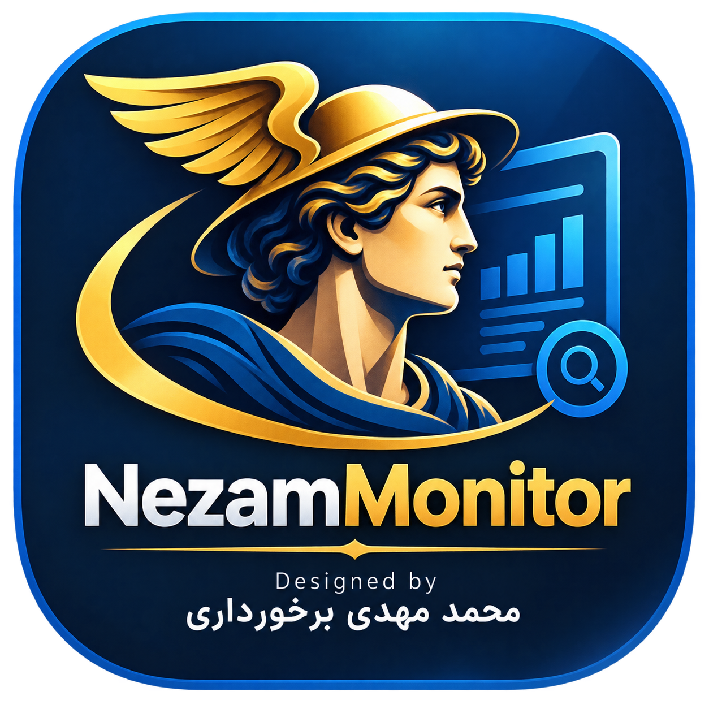

<div align="center">



# Nezam Monitor Pro
### سیستم جامع پایش و مدیریت پرونده‌های نظام مهندسی

**نرم‌افزار دسکتاپ حرفه‌ای و امن برای مهندسان ناظر و طراح سازمان نظام مهندسی یزد**

[](https://github.com/Barkhordari-dev/NezamMonitor/releases)
[](https://dotnet.microsoft.com/)
[](https://learn.microsoft.com/en-us/dotnet/desktop/wpf/)
[](https://github.com/Barkhordari-dev/NezamMonitor/releases)
[](https://www.zetetic.net/sqlcipher/)

[🌐 وب‌سایت معرفی و دانلود](https://nezammonitor-pro.ai.studio/) &nbsp;·&nbsp; [⬇️ دریافت آخرین نسخه](https://github.com/Barkhordari-dev/NezamMonitor/releases) &nbsp;·&nbsp; [🤖 نسخه اندروید](https://github.com/Barkhordari-dev/NezamMonitor-Android-UI)

</div>

---

## دربارهٔ نرم‌افزار

**نظام مانیتور پرو (Nezam Monitor Pro)** یک نرم‌افزار دسکتاپ حرفه‌ای، امن و کاملاً بومی‌سازی‌شده است که برای مهندسان ناظر و طراح سازمان نظام مهندسی طراحی شده است. این برنامه با هدف ساده‌سازی و خودکارسازی فرآیندهای روزمرهٔ مدیریت پرونده‌های نظارت، پیگیری حق‌الزحمه، تولید گزارش‌های مرحله‌ای و نگهداری اطلاعات کاری توسعه یافته است.

با استفاده از این نرم‌افزار، نیاز به ورود مکرر به سامانهٔ نظام مهندسی و استخراج دستی اطلاعات به‌طور کامل برطرف می‌شود. تمامی داده‌ها یک‌بار استخراج و در پایگاه دادهٔ محلی رمزنگاری‌شده ذخیره می‌گردند و از آن پس به‌راحتی قابل جستجو، ویرایش، پیگیری و گزارش‌گیری هستند.

🎬 [معرفی ویدیویی کامل برنامه (ویندوز و اندروید)](https://nezammonitor-pro.ai.studio/) — در ۸ فصل کوتاه با استخراج خودکار پرونده‌ها، محاسبه حق‌الزحمه، تولید گزارش‌های Word و PDF و همگام‌سازی امن آشنا شوید.

---

## امکانات و قابلیت‌های اصلی

### ۱. همگام‌سازی و استخراج خودکار اطلاعات
- ورود یک‌باره به سامانهٔ نظام مهندسی با نام کاربری و رمز عبور
- استخراج و به‌روزرسانی خودکار تمامی پرونده‌ها، مشخصات مهندسین، وضعیت مراحل و اطلاعات مالی
- ذخیرهٔ اطلاعات در پایگاه دادهٔ محلی برای دسترسی سریع و آفلاین

### ۲. مدیریت جامع پرونده‌ها
- مشاهده، جستجو و فیلتر پیشرفتهٔ پرونده‌ها
- نمایش جزئیات کامل هر پرونده شامل مشخصات مالک، نشانی، رشته‌ها، ناظرین و وضعیت مراحل
- امکان افزودن و ویرایش یادداشت‌های پیگیری برای هر پرونده

### ۳. مدیریت حق‌الزحمه و امور مالی
- محاسبه و نمایش حق‌الزحمه بر اساس مالک، مرحله، رشته و وضعیت پرداخت
- پیگیری اقساط، فیش‌های واریزی و وضعیت تسویه
- خلاصه‌سازی مالی و گزارش‌های مقایسه‌ای

### ۴. تولید خودکار گزارش‌های ورد
- تولید گزارش‌های استاندارد مرحلهٔ اول تا چهارم با قالب‌های حرفه‌ای Word
- جایگذاری خودکار اطلاعات پرونده، نام ناظر و سایر فیلدها در قالب
- امکان تولید خروجی PDF از گزارش‌های تولیدشده

### ۵. خروجی‌گیری و پشتیبان‌گیری
- صدور گزارش‌های جامع به فرمت اکسل
- تولید فایل پشتیبان با پسوند `.nzmdata` برای انتقال به نسخهٔ موبایل
- امکان پشتیبان‌گیری و بازیابی کامل داده‌ها

### ۶. امنیت و رمزنگاری پیشرفته
- ذخیره‌سازی تمامی اطلاعات در پایگاه دادهٔ محلی رمزنگاری‌شده با SQLCipher
- استفاده از الگوریتم Argon2id برای هش رمز عبور
- امکان تغییر امن رمز عبور ورود و رمزنگاری پایگاه داده از داخل برنامه

### ۷. رابط کاربری مدرن و کاملاً فارسی
- طراحی راست‌چین (RTL) با پشتیبانی کامل از زبان فارسی
- تم‌های روشن و تاریک با قابلیت شخصی‌سازی
- فونت‌های استاندارد فارسی و خوانایی بالا در جداول و فرم‌ها
- تجربهٔ کاربری روان و واکنش‌گرا

---

## 🆕 تازه‌ترین نسخه — v12.5

- **جایگذاری «نام ناظر» در گزارش:** جایی که در قالب گزارش «نام ناظر» نوشته شده، اسم و فامیل خودت می‌نشیند؛ یعنی اسم همان حسابی که با آن وارد سامانه شده‌ای. با هر دو شکل جای‌نگه‌دار کار می‌کند: هم «نام ناظر» با گیومهٔ فارسی و هم `"نام ناظر"` با گیومهٔ ساده — و در گزارش PDF هم اسم می‌آید.
- **قالب‌های ۱ تا ۳ به‌روز شدند:** «نام ناظر» در آن‌ها حالا با گیومهٔ فارسی نوشته شده و با بقیهٔ جای‌نگه‌دارها یکدست است.

---

## 🔄 ارتباط با نسخه اندروید

داده‌ها میان نسخه ویندوز و نسخه اندروید با فایل `.nzmdata` (قالب v2) جابه‌جا می‌شوند:

```
Windows (v12.5) → Export (.nzmdata v2) → Android (v3.9.0)
Android (v3.9.0) → Follow-up Edits → Export → Windows (v12.5)
```

- **بسته‌های رمزدار:** رمزنگاری **AES-256-GCM** با کلید مشتق **PBKDF2-SHA256** (۶۰۰٬۰۰۰ تکرار) و بررسی صحت **SHA-256** — با رمز عبور یا بدون رمز.
- **حفظ پرونده‌های بایگانی‌شده:** وارد کردن فایل جدید هرگز پرچم بایگانی را حذف نمی‌کند.
- **ادغام هوشمند پیگیری‌ها:** تازه‌ترین زمان ویرایش (`updatedAt`) اعمال می‌شود و در صورت تساوی، نسخه ویندوز برنده است.
- **سازگاری کامل:** ویندوز v12 به بعد با اندروید v3.9.0 (قالب v2) هماهنگ است.

📲 نسخه اندروید: [NezamMonitor-Android-UI](https://github.com/Barkhordari-dev/NezamMonitor-Android-UI) — نسخهٔ v3.9.0

---

## نحوهٔ نصب و اجرا

1. آخرین نسخهٔ قابل‌حمل (`NezamMonitor-Windows-v12.5-Portable.zip`) را از بخش [Releases](https://github.com/Barkhordari-dev/NezamMonitor/releases) دانلود کنید.
2. فایل فشرده را در یک پوشهٔ خالی استخراج نمایید.
3. فایل `NezamMonitorPro.exe` را اجرا کنید.
4. در اولین اجرا، یک رمز عبور قوی برای رمزنگاری پایگاه دادهٔ محلی تعیین کنید.

> **نکته:** برنامه به‌صورت Self-Contained ارائه می‌شود و نیازی به نصب جداگانهٔ .NET Runtime ندارد. پوشهٔ `templates` باید در کنار فایل اجرایی باقی بماند.

---

## پیش‌نیازهای سیستم

| مورد              | حداقل مورد نیاز                  |
|-------------------|----------------------------------|
| سیستم‌عامل        | ویندوز ۱۰ یا ۱۱ (۶۴ بیت)         |
| حافظهٔ رم         | ۴ گیگابایت                       |
| فضای دیسک         | حدود ۱۵۰ مگابایت                 |
| نرم‌افزار اختیاری | Microsoft Word (برای مشاهدهٔ گزارش‌ها) |

---

## فناوری‌های به‌کاررفته

- **چارچوب:** ‎.NET 10‎ (WPF)
- **پایگاه داده:** SQLite همراه با SQLCipher (رمزنگاری‌شده)
- **معماری:** MVVM (CommunityToolkit.Mvvm)
- **امنیت:** Argon2id + AES Encryption
- **خروجی گزارش:** DocumentFormat.OpenXml و ClosedXML

---

## توسعه‌دهنده

**مهندس محمدمهدی برخورداری**

برای گزارش باگ، پیشنهاد ویژگی یا ارتباط با توسعه‌دهنده، از بخش Issues مخزن گیت‌هاب استفاده نمایید.

---

*این نرم‌افزار با هدف افزایش بهره‌وری مهندسان ناظر و کاهش کارهای تکراری و زمان‌بر طراحی و توسعه یافته است.*

*این برنامه برای استفادهٔ همگانی ساخته شده است؛ فروش یا سوءاستفاده از آن مورد رضایت نیست.*
